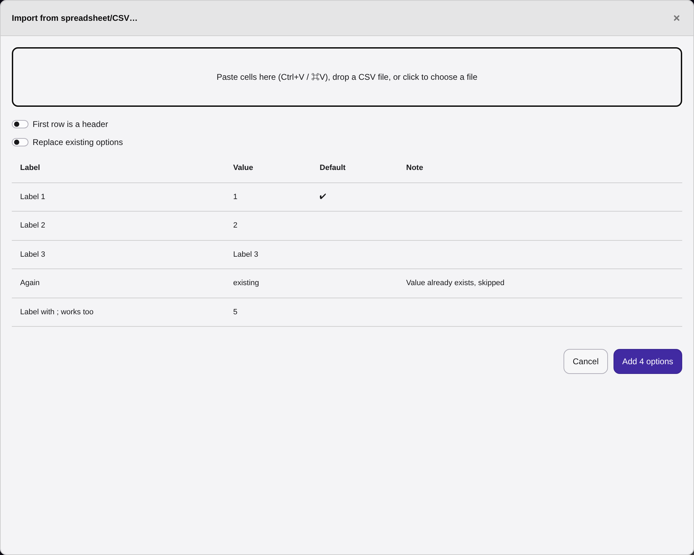
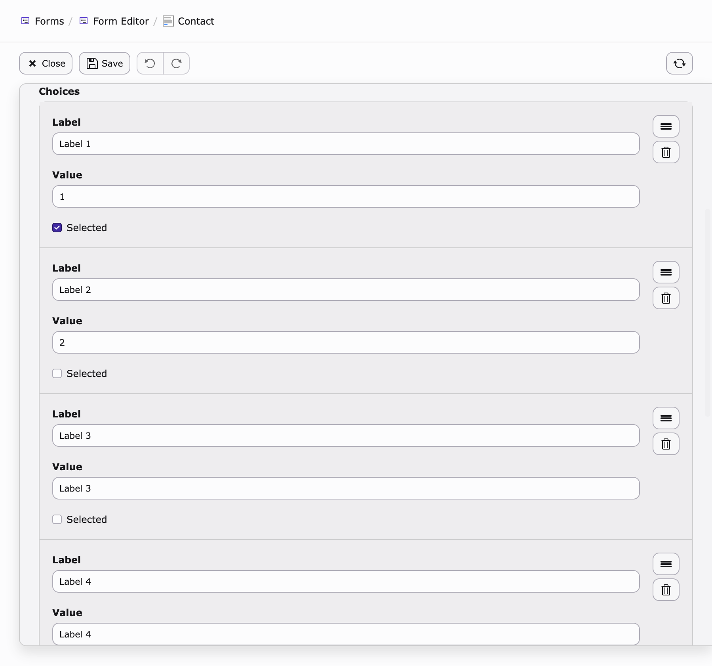

# Import form select options from a spreadsheet or CSV file

## What does it do?

The extension adds an **Import from spreadsheet/CSV…** button to these form elements in the TYPO3 form editor:

* Single select
* Multi select
* Multi checkbox
* Radio button

These are all elements with a _Choices_ field.

Click the button, then paste cells copied from Excel, Google Sheets, LibreOffice or Numbers, or drop a CSV file. A preview shows every row before anything changes:

Click **Add N options**. The rows appear in _Choices_ right away, no save needed. Save the form as usual. The undo button of the form editor removes the whole import in one step.

## Supported versions

| Extension | TYPO3                | PHP        |
|-----------|----------------------|------------|
| 3.x       | 12.4, 13.4, 14.3 LTS | 8.2 to 8.5 |

Only these LTS versions are tested and supported. For TYPO3 11.5, use version 2.x.

## Installation

    composer require "plan2net/form-options-csv"

## Columns

Each row has up to three columns:

    label | value | default

* **label**: the text the visitor sees. Required. Rows without a label are skipped.
* **value**: the value that is submitted. Optional. If it is empty, the label is used.
* **default**: marks the option as selected by default. Leave it empty or use `0` for "no". Anything else means "yes".

Columns after the third are ignored. Empty rows are skipped.

## Adding or replacing

Imported options are **added below** the existing options. Switch on **Replace existing options** to remove the existing options first. This switch always starts off.

Switch on **First row is a header** if your sheet has a header row. The modal remembers this switch.

## Separators

* **Pasted cells** from a spreadsheet are separated by tabs. Pasted text without tabs is split on `;`. Commas never split pasted text, so labels like "Vienna, Austria" work.
* **CSV files** may use tab, `;` or `,`. The import looks at the first row and uses the separator that appears most often.
* Put a label in double quotes (`"Label with ; works too"`) to use the separator inside it.
* Files may be saved as UTF-8 or in the older Windows encoding of Excel. Both work.
* Excel workbooks (`.xlsx`) cannot be imported directly. Copy the cells or save the sheet as CSV.

## Example

    Label 1;1;1
    Label 2;2
    Label 3
    Label 4;;1
    "Label with ; works too";5;1

* `Label 1;1;1`: label "Label 1", value "1", selected by default.
* `Label 2;2`: label "Label 2", value "2".
* `Label 3`: label and value are "Label 3".
* `Label 4;;1`: label and value are "Label 4", marked as default.
* `"Label with ; works too";5;1`: label "Label with ; works too", value "5", marked as default.

## Rules

* **Same value twice:** a row whose value already exists, or appears earlier in the import, is skipped. The preview says why.
* **Defaults on single select and radio button:** only one default is allowed. The first marked row becomes the default and replaces the old one. Later marks are dropped, and the preview says so.
* **Defaults on multi select and multi checkbox:** every marked row becomes a default, in addition to the existing ones.
* **Broken quotes:** if a quote is not closed, nothing is imported and the preview names the line.
